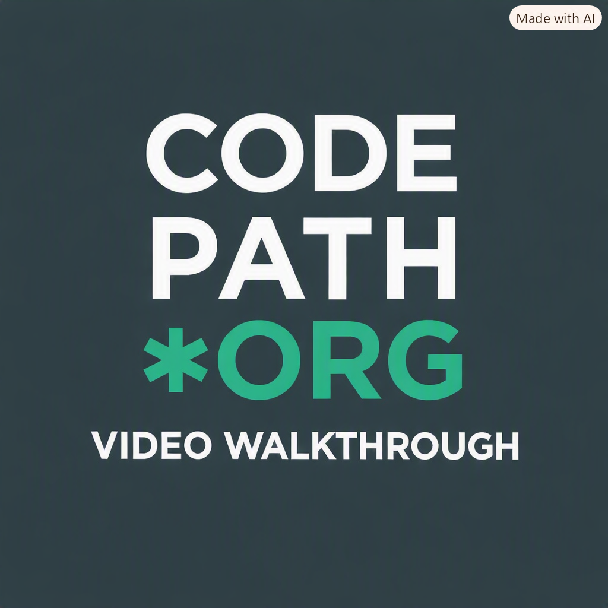

# Web Development Final Project - *HobbyHub Farm Blogs*

Submitted by: **Amine Benelbar**

This web app: **Users can make posts and edit and delete the posts they made. Supabase access policies were added to restrict users to only add, edit, and delete their posts and comments. Users may only add one upvote per post. Posts have many comments.**

Time spent: **X** hours spent in total

## Required Features

The following **required** functionality is completed:

- [X ] **Web app includes a create form that allows the user to create posts**
  - Form requires users to add a post title
  - Forms should have the *option* for users to add: 
    - additional textual content
    - an image added as an external image URL
- [X ] **Web app includes a home feed displaying previously created posts**
  - Web app must include home feed displaying previously created posts
  - By default, each post on the posts feed should show only the post's:
    - creation time
    - title 
    - upvotes count
  - Clicking on a post should direct the user to a new page for the selected post
- [X ] **Users can view posts in different ways**
  - Users can sort posts by either:
    -  creation time
    -  upvotes count
  - Users can search for posts by title
- [ X] **Users can interact with each post in different ways**
  - The app includes a separate post page for each created post when clicked, where any additional information is shown, including:
    - content
    - image
    - comments
  - Users can leave comments underneath a post on the post page
  - Each post includes an upvote button on the post page. 
    - Each authenticated Supabase user, including visitors signed in anonymously by the app, can upvote a post once and remove their own upvote

- [X ] **A post that a user previously created can be edited or deleted from its post pages**
  - After a user creates a new post, they can go back and edit the post
  - A previously created post can be deleted from its post page

The following **optional** features are implemented:

- [X ] Web app implements pseudo-authentication
  - Supabase anonymously signs the browser in, and its persistent user ID is associated with posts and comments
  - Only the original anonymous user can edit or delete their posts and comments, enforced by row-level security
- [X ] Users can repost a previous post by referencing its post ID. On the post page of the new post
  - Users can repost a previous post by referencing its post ID
  - On the post page of the new post, the referenced post is displayed and linked, creating a thread
- [X ] Users can customize the interface
  - e.g., selecting the color scheme or showing the content and image of each post on the home feed
- [X ] Users can add more characterics to their posts
  - Users can share and view web videos
  - Users can set flags such as "Question" or "Opinion" while creating a post
  - Users can filter posts by flags on the home feed
  - Users can upload images directly from their local machine as an image file
- [ ] Web app displays a loading animation whenever data is being fetched

The following **additional** features are implemented:

* [X ] List anything else that you added to improve the site's functionality!
  - I added a supabase query to find whether the author of the post is the same as the one as the author id, supabase gave to the user, essentially the user that is currently logged in. I used The supabase query helpers sign visitors in anonymously before writes and voting—there is no password or author-ID prompt. I used a supabase method to find whether the author has given their upvote to the respective post or not; this is activite every time the upvote button in the page of a post is clicked. I greatly used PL/SQL triggers and methods. I wanted to reuse so made a component called FarmBlogForm to be used for the components to edit, add, and see the posts. I used TipTap starter kit to make the component to edit the respective post. I searched whether it is better to use plain inputs like text area when adding and editing text. I was recommended to use Tiptap to make professional text editors.  

## Supabase setup

The Supabase query helpers sign visitors in anonymously before writes and voting—there is no password or author-ID prompt. Supabase keeps that identity in the browser so RLS can restrict edits, deletes, and one vote per post. Clearing browser storage loses access to posts and comments created by that anonymous identity; a new browser identity can vote again. Existing `upvotes_count` values are retained when adding vote tracking, but older votes cannot be attributed to users or removed through the new toggle. The create, edit, and detail routes use these helpers; the feed and comments UI still need to be connected.

I set columns such as the id fields the uuid instead of int data types for better security.

## Video Walkthrough

Here's a walkthrough of implemented user stories:

 

<!-- Replace this with whatever GIF tool you used! -->
GIF created with ...  
[LiceCap](https://www.cockos.com/licecap/) 
<!-- Recommended tools:
[Kap](https://getkap.co/) for macOS
[ScreenToGif](https://www.screentogif.com/) for Windows
[peek](https://github.com/phw/peek) for Linux. -->

## Notes

Describe any challenges encountered while building the app.

## License

    Copyright [2026] [Amine Benelbar]

    Licensed under the Apache License, Version 2.0 (the "License");
    you may not use this file except in compliance with the License.
    You may obtain a copy of the License at

        http://www.apache.org/licenses/LICENSE-2.0

    Unless required by applicable law or agreed to in writing, software
    distributed under the License is distributed on an "AS IS" BASIS,
    WITHOUT WARRANTIES OR CONDITIONS OF ANY KIND, either express or implied.
    See the License for the specific language governing permissions and
    limitations under the License.
